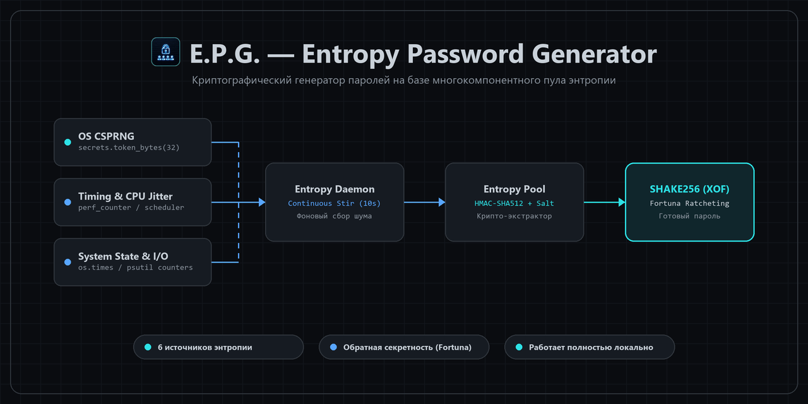

<div align="center">



<br>

# 🔐 E.P.G. — Entropy Password Generator
**Десктопный генератор паролей для Windows на базе криптографического пула энтропии**

[]()
[]()
[]()
[]()

</div>
---

Локальная утилита под Windows для генерации криптографически стойких паролей. Вместо того чтобы полагаться на один базовый вызов ГПСЧ, **E.P.G.** использует собственный многопоточный движок (`entropy_engine.py`), который непрерывно собирает и микширует энтропию из нескольких независимых системных источников.

### ⚙️ Как устроен Entropy Engine
* **Многокомпонентный сбор (Multi-source):** основным якорем выступает системный `os_csprng` (`secrets.token_bytes`), который дополняется шумом таймингов выполнения (`timing_jitter`), процессорного времени потока (`thread_time_jitter`), задержек планировщика ОС (`scheduler_jitter`), снимком состояния процесса (`system_state`) и системными счетчиками сети/диска (`system_io` через `psutil`).
* **Криптографический миксер:** сырые данные сжимаются через `HMAC-SHA512` с уникальной 16-байтной солью сессии и расширяются до нужной длины через XOF-функцию `SHAKE256`.
* **Фоновый демон (`EntropyDaemon`):** каждые 10 секунд подмешивает свежую порцию шума в аккумулятор в отдельном потоке без блокировки интерфейса.
* **Обратная секретность (Fortuna-style ratcheting):** каждое чтение из пула необратимо прокручивает внутреннее состояние вперед — даже при компрометации текущего состояния пула восстановить прошлые сгенерированные пароли невозможно.

### 🖥️ Возможности интерфейса
* Кастомный киберпанк-интерфейс на базе `pywebview` с фоновой Matrix-анимацией на Canvas.
* Индикатор среза пула в реальном времени и живой лог источников энтропии с разбивкой по байтам.
* Гибкая настройка длины (`4–128` символов) и наборов (`a-z`, `A-Z`, `0-9`, `!@#`) с автоматическим расчетом бит энтропии.
* Встроенный блок самодиагностики движка (**«Запустить проверки»** / **Run Sanity Checks**).
* Переключение языка интерфейса на лету (**RU / EN**).

---

### 📥 Скачать и запустить
Готовый к работе бинарник для Windows (не требует установленного Python) доступен в разделе **[Releases](../../releases)**.

### 🛠️ Запуск из исходников и сборка `.exe`

```cmd
git clone [https://github.com/U9iN/Entropy-Password-Generator.git](https://github.com/U9iN/Entropy-Password-Generator.git)
cd Entropy-Password-Generator
pip install pywebview psutil
python gui_launcher.py
```

Для компиляции собственного `.exe` через PyInstaller используй комплектный скрипт `build.bat`:
* `build.bat` — стандартная сборка в папку `dist\E.P.G. - Entropy Password Generator`
* `build.bat onefile` — сборка в один автономный `.exe`
* `build.bat debug` — сборка с открытым окном консоли для отладки

---

<details>
<summary><b>🌐 English version (click to expand)</b></summary>
<br>

**E.P.G. (Entropy Password Generator)** is a standalone Windows desktop utility for generating cryptographically strong passwords. Instead of relying on a single PRNG call, it runs a background daemon that continuously harvests and mixes system noise into a cryptographic entropy pool.

#### Key Features
* **Multi-Source Harvesting:** Anchored by `os_csprng` and seasoned with execution timing jitter, thread CPU-time deltas, OS scheduler thread-switch jitter, process state, and system-wide disk/network I/O counters (`psutil`).
* **Cryptographic Extraction & Fortuna Ratcheting:** Raw inputs are extracted via `HMAC-SHA512` (using a per-instance random salt) and expanded via `SHAKE256` (XOF) with full backward secrecy.
* **Transparent Diagnostics:** Live pool preview, per-source byte breakdown log, entropy bit-strength meter, and built-in engine sanity checks.
* **Bilingual UI:** Instant RU / EN switch right from the top bar.

Pre-built Windows binaries are available on the **[Releases](../../releases)** page.
</details>
